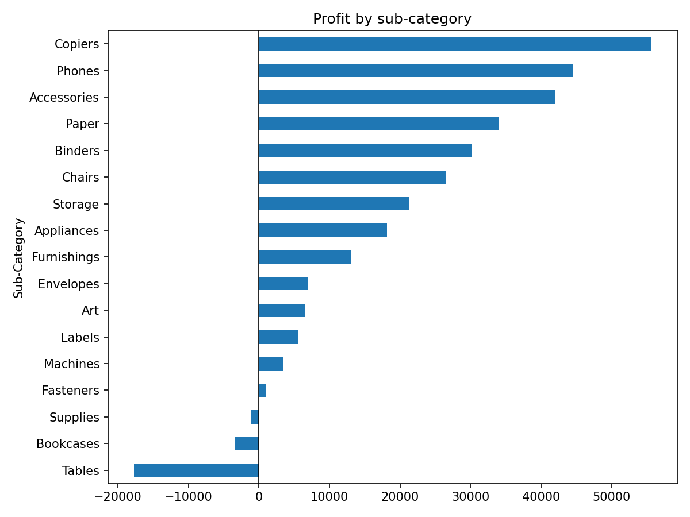
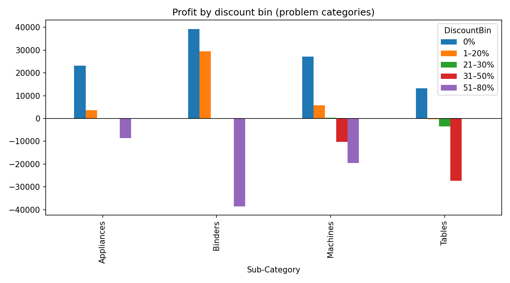

# Superstore EDA

Live page: https://sergioacast.github.io/portfolio/projects/analytics/superstore/ · Notebook: [superstore_eda.ipynb](superstore_eda.ipynb) · [Rendered notebook](https://sergioacast.github.io/portfolio/projects/analytics/superstore/notebook.html)

## Question

Where does Superstore lose profit (sub-category, discount level, region × segment, ship mode), and what would capping discounts at 20% have changed?

## Data

[Superstore Dataset](https://www.kaggle.com/datasets/vivek468/superstore-dataset-final) (Kaggle). 9994 order lines × 21 columns (US only), 5009 orders, 793 customers. Read with latin-1 encoding because the CSV has non-UTF-8 bytes.

## Methods and tools

**Tools:** Python, pandas, matplotlib

- Sanity checks: describe(), discount levels, quantity range, negative-profit rows (1871), zero sales (0), duplicate Row IDs (0).
- Derived ship days, profit margin and discount bins (0%, 1–20%, 21–30%, 31–50%, 51–80%) with `pd.cut`.
- Grouped sales/profit/margin by sub-category × discount bin, sub-category, region × segment and ship mode.
- Charts: net profit by sub-category; profit by discount bin for Binders, Tables, Appliances and Machines.
- Counterfactual: recomputed each line’s list price, capped discount at 20%, kept cost fixed, and compared total profit.

## Key findings

- Three sub-categories lose money overall: Tables −$17,725, Bookcases −$3,473, Supplies −$1,189. The largest profits are Copiers $55,618, Phones $44,516 and Accessories $41,937.
- Total profit by discount bin: 0% $320,988, 1–20% $100,785, 21–30% −$10,369, 31–50% −$48,448, 51–80% −$76,559 (mean line margin −1.139 in the top bin).
- Worst sub-category × discount cells: Binders 51–80% −$38,510 (613 lines), Tables 31–50% −$27,296 (122 lines), Machines 51–80% −$19,579 (23 lines).
- 1871 of 9994 lines have negative profit.
- By region × segment, the lowest profit is South Home Office ($4,621) and the lowest margin is Central Consumer (0.034, avg discount 0.252).
- By ship mode, margins range from 0.121 (Standard Class) to 0.139 (First Class).
- 20% discount cap counterfactual: 1393 lines affected; profit $286,397 → $505,588 (delta +$219,191). Largest deltas: Binders +$78,343, Machines +$55,816, Tables +$29,500. This estimate assumes sales volume stays the same after the cap.

Numbers are taken directly from the notebook outputs.

## Charts

*Net profit by sub-category*

*Profit by discount bin (Binders, Machines, Tables, Appliances)*

## Get the data

Source: [Superstore Dataset](https://www.kaggle.com/datasets/vivek468/superstore-dataset-final) (Kaggle). The CSV is not included in this repo.

1. Download the dataset from the Kaggle page above and unzip it.
2. Save the CSV in this folder (`projects/analytics/superstore/`) as `superstore.csv`, next to `superstore_eda.ipynb` (rename it if the download has a different name).
3. Run the notebook top to bottom (it reads the file with `encoding="latin-1"`).
